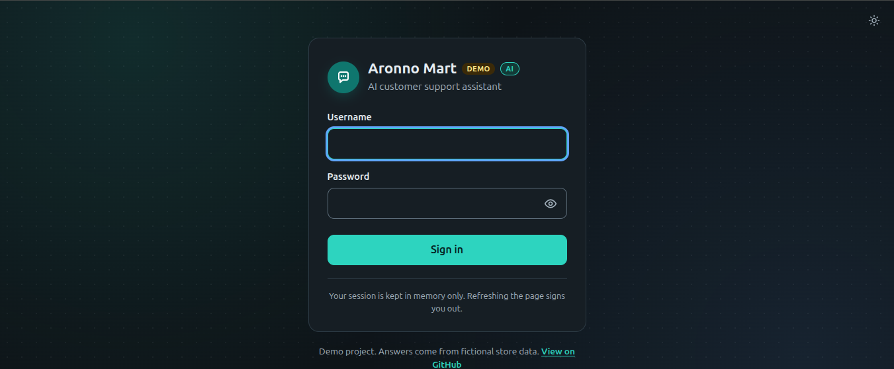
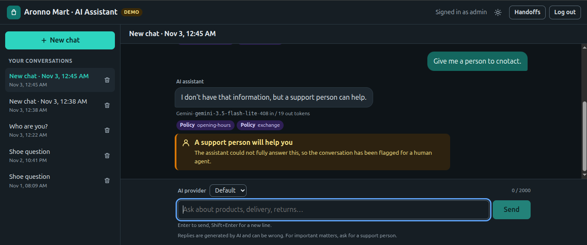
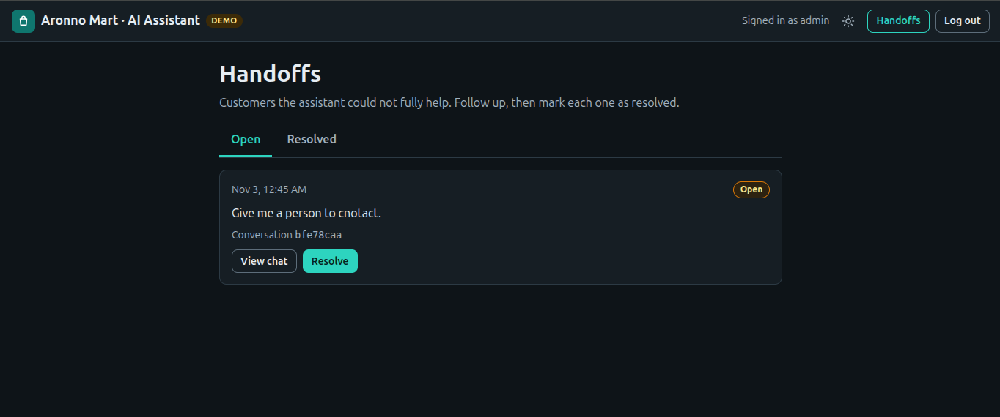

# ai-chatbot-ui

A React chat UI for **Aronno Mart**, a fictional online store. It is the frontend for
[ai-chatbot-api](https://github.com/softDevShishir/ai-chatbot-api), a Spring Boot customer-support
chatbot that answers from store products and policies using Claude, Gemini or OpenAI.

Features:

- Log in with the backend's admin account. The JWT is kept **in memory only**.
- A conversation list with **New chat** and **delete** (asks for confirmation first).
- Chat bubbles: the customer on the right, the assistant on the left. An "AI assistant is typing…" indicator shows while waiting.
- A provider picker (Default / Claude / Gemini / OpenAI).
- Under each reply: provider, model, token counts, and the store **sources** (policy/product chips) it used.
- A **"A support person will help you"** banner when the assistant hands off to a human.
- Example questions on an empty chat.
- A **Handoffs** page for support staff (`/handoffs`, linked in the header with a badge for open requests). Open and Resolved tabs list customers the assistant could not fully help; **View chat** opens the conversation and **Resolve** marks it done.
- Friendly messages for 400 / 401 / 404 / 409 / 429 / 502 / 503.
- Light and dark mode, a responsive layout down to phone width, keyboard access and ARIA labels.

## Screenshots

_Placeholder: add images to [`docs/screenshots/`](docs/screenshots/) and link them here, e.g._

```md





```

## Running the backend and the UI together

You need Docker for the backend, and Node.js `^20.19` or `>=22.12` for the UI. Node 24 is recommended.
Node 22.5.0 has an npm bug that breaks installs.

**1. Backend** (in a clone of [ai-chatbot-api](https://github.com/softDevShishir/ai-chatbot-api)):

```bash
cp .env.example .env
# edit .env: set JWT_SECRET, ADMIN_USERNAME / ADMIN_PASSWORD and at least one AI provider key
docker compose up --build
```

The API listens on `http://localhost:8080`.

**2. UI** (this repo):

```bash
npm install
npm run dev
```

Open http://localhost:5173 and sign in with the `ADMIN_USERNAME` / `ADMIN_PASSWORD` you set on the backend.

In development the browser talks only to the Vite server. Vite forwards `/api/*` to the backend
(the **dev proxy**), so no CORS setup is needed.

### Other commands

```bash
npm test         # Vitest + Testing Library, fetch is mocked (no backend needed)
npm run build    # type-check and build to dist/
npm run lint
npm run preview  # serve the built dist/ locally
```

## Configuration

Copy `.env.example` to `.env.local` if you need to change anything. There are no secrets here.
Any `VITE_*` value used in `src/` is compiled into the public JavaScript bundle.

| Variable | Default | Used by | Notes |
|---|---|---|---|
| `VITE_API_PROXY_TARGET` | `http://localhost:8080` | Vite dev server only | Where `npm run dev` forwards `/api` |
| `VITE_API_BASE_URL` | _(empty)_ | Built app | Backend origin when the UI is hosted separately, e.g. `https://api.example.com`. Empty means the same origin |

### Hosting the UI separately (CORS)

If the built UI is served from a different origin than the API (for example, the UI on
`https://chat.example.com` and the API on `https://api.example.com`):

1. Build the UI with `VITE_API_BASE_URL=https://api.example.com npm run build` and host `dist/`.
   Configure the host to serve `index.html` for unknown paths, so routes like `/chats/<id>` work on reload.
2. On the **backend**, set `CORS_ALLOWED_ORIGINS=https://chat.example.com`. It takes a
   comma-separated list of exact origins and rejects wildcards. When it is blank, CORS is off and the
   browser blocks the UI's requests.

The backend allows `GET`, `POST`, `DELETE` and the `Authorization` and `Content-Type` headers for `/api/**`,
which is everything this UI uses. Alternatively, serve the UI and the API behind one reverse proxy on a
single origin, with `/api` routed to the backend. Then no CORS setup is needed.

## How it talks to the API

| UI action | Request |
|---|---|
| Sign in | `POST /api/auth/login` `{ username, password }` → `{ token }` |
| Conversation list | `GET /api/chats` |
| New chat | `POST /api/chats` `{}`. Sending from the start screen creates `{ title: <first message> }` |
| Open a chat | `GET /api/chats/{id}` |
| Delete | `DELETE /api/chats/{id}` (after confirming) |
| Send | `POST /api/chats/{id}/messages` `{ message, provider? }`. `provider` is sent only when it is not "Default" |
| Handoffs list and badge | `GET /api/handoffs?status=OPEN` or `RESOLVED` |
| Resolve a handoff | `POST /api/handoffs/{id}/resolve` |

All requests except login carry `Authorization: Bearer <token>`.

## Tech stack

- React 19, TypeScript 6, Vite 8, React Router 7
- Vitest 5, Testing Library, jsdom
- ESLint (typescript-eslint, react-hooks, react-refresh)
- Plain CSS with custom properties (no UI framework)

## Limitations

- **Demo data.** The store, products and policies are fictional.
- **No streaming.** Each reply arrives as one response, so the UI shows "typing…" until it is complete.
- **One admin account.** The backend has a single login; there are no per-customer accounts.
- **The token is lost on refresh.** It lives only in memory, so reloading the page means signing in again.
- **Sources and the handoff banner are shown only for replies received in this session.** The backend's
  chat history (`GET /api/chats/{id}`) does not include them, so older replies show only provider, model and tokens.
- **Replies are shown as plain text.** Markdown from the model is not rendered.
- **Chats cannot be renamed.** The backend has no rename endpoint.

## License

[MIT](LICENSE)
